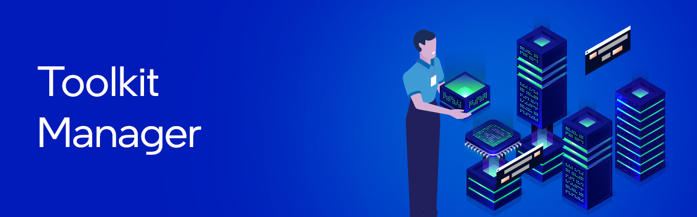

# Toolkit Manager

[](LICENSE)
[](https://www.intel.com)
[](https://kubernetes.io)
[](https://vllm.ai)
[](https://gateway.envoyproxy.io)
[](https://platform.openai.com/docs/api-reference)

**The fast path to deploying AI on Intel® platforms. Go from bare metal to a working AI stack with one installer.**

> Deploy and connect LLM inference, RAG, and agentic workflows in a customizable Kubernetes-based platform — with a GenAI gateway, security, intelligent routing, observability, model serving, and infrastructure automation built in.

---

## What is Toolkit Manager?

A production AI stack needs more than a model endpoint: LLM inference, RAG and agents, plus security, routing and observability, all connected.

Toolkit Manager wires these together in a pre-integrated, customizable Kubernetes stack optimized for Intel® platforms. One installer, `toolkit_manager.sh`, takes bare-metal machines through Kubernetes, platform services, model serving and the AI gateway, and ends with secured, OpenAI-compatible endpoints. Start with the defaults, then configure or extend as needed.

## Architecture

The stack is built in **layers**, each on top of the one before. You pick a **target** (the top layer you want), and the installer adds every layer below it for you.

| # | Layer | In short | What it installs | Install target | Learn more |
| --- | --- | --- | --- | --- | --- |
| 1 | **Infrastructure** | The cluster your machines become | Kubernetes (built with Kubespray) and storage (local-path, NFS, Ceph, NetApp ONTAP, or your own CSI driver) | `infrastructure` | [Quick Start: Layer 1](#layer-1-infrastructure) |
| 2 | **Platform** | Shared services every layer uses: the front door, sign-in, encryption, monitoring, databases | Envoy Gateway, Keycloak, cert-manager, Istio ambient mesh, MetalLB, PostgreSQL, SeaweedFS, observability (Grafana, Prometheus, Loki, Tempo), Node Feature Discovery, NRI CPU balloons, metrics-server, the Intel GPU device plugin, the Kubernetes cluster dashboard (Headlamp); opt-in KEDA, Velero | `platform` | [Quick Start: Layer 2](#layer-2-platform) |
| 3 | **Intel® Inference Toolkit** | Serves models behind one OpenAI-compatible API | Envoy AI Gateway, KServe, vLLM / OpenVINO™ Model Server, optional LiteLLM and Langfuse | `inference` | [inference-toolkit](https://github.com/intel/inference-toolkit) |
| 4 | **Intel® Chatbot Toolkit** *(optional, on top of 3)* | Chat with your own documents (RAG) | Vector database, document ingestion, RAG pipeline, MCP gateway, chat history, web UI | `erag` | [chatbot-toolkit](https://github.com/intel/chatbot-toolkit) |
| 4 | **Intel® Agent Toolkit** *(optional, on top of 3)* | Run AI agents safely | Agent sandboxes (optionally Kata microVMs), memory stores (Redis Stack, pgvector), LiteLLM virtual keys, guardrails, a hybrid model router; optional KubeRay | `agent-toolkit` | [agent-toolkit](https://github.com/intel/agent-toolkit) |

> [!NOTE]
> **You never clone the other repositories yourself: `init` downloads the ones your target needs into `ext/`. New to a term? The [Glossary](docs/reference/glossary.md) defines each one in a line or two.**

**Request flow:** a request enters through Envoy Gateway, which checks its credential (a Keycloak token, or a LiteLLM virtual key). The Envoy AI Gateway then routes it to the server running the requested model. Every layer's health and latency is visible in the built-in Grafana, Prometheus, Loki and Tempo stack.

<p align="center">
  
</p>

---

## Quick Start

Walk up the layers on one machine with the default settings, and stop at the one you need. Installing a layer also installs every layer below it, so you can also go straight to it (`init inference` + `install inference` builds layers 1–3). The first install takes up to an hour, mostly downloading images.

> [!NOTE]
> **Prerequisites:** Ubuntu 22.04/24.04 (or RHEL/Rocky Linux), `git`, `sudo` rights (passwordless is easiest), internet access, and at least **32 CPU cores, 64 GB RAM and 300 GB disk** for a small model (16 cores, 32 GB, 200 GB for the platform alone). Details → [Prerequisites](docs/getting-started/prerequisites.md). Several machines or an existing cluster → [Getting Started](docs/getting-started/quickstart.md).

### Prepare the machine

```bash
git clone https://github.com/intel/toolkit-manager.git
cd toolkit-manager
./toolkit_manager.sh configure      # once per machine (sudo, asks first): Python 3.11+, yq, kubectl, helm, .venv/
./toolkit_manager.sh init platform  # creates env/local/ with your settings
```

> [!NOTE]
> **Every configuration file you need is created in `env/local/`. Edit them there: there is nothing to change anywhere else in the repository.**

**`env/local/global_config.yaml` holds the settings shared by every layer.** The defaults work as they are; edit before you install to change them. A few of its lines:

```yaml
base_domain_name: "inteltoolkits.ai"   # all URLs: grafana.<domain>, keycloak.<domain>, ...
storage_backend: local-path            # local-path (single node) | nfs | ceph | netapp-trident | custom
observability_enabled: true            # Grafana, Prometheus, Loki, Tempo
headlamp_enabled: true                 # Kubernetes cluster dashboard
# http_proxy: "http://your-proxy:8080" # behind a proxy: uncomment http_proxy, https_proxy and no_proxy
# auth_type: "jwt"                     # API sign-in: jwt | litellm_vkey
# llm_services_deploy_models: false    # true: deploy the catalog models marked autodeploy during the install
```

**Each toolkit layer adds its own settings file** when you `init` it, with that layer's detailed options: `config.inference.yaml`, `config.agent-toolkit.yaml` or `config.erag.yaml`, next to `global_config.yaml`. A key set in both wins in `global_config.yaml`. All options and the full order → [Configuration Reference](docs/configuration/configuration.md#changing-values).

### Layer 1: Infrastructure

**What you get:** a Kubernetes cluster (built with Kubespray) and storage for the layers above. By default it is a **single node**, this machine; for several machines, set up **Multi-node** first.

> [!TIP]
> **Multi-node:** before installing, list your machines in `env/local/nodes.yaml` (reached over key-based, passwordless SSH) and set `storage_backend: nfs` (or `ceph`) in `global_config.yaml`, since `local-path` is single-node only:
>
> ```yaml
> nodes_control_plane: [{ ip: 10.0.0.10, hostname: cp1 }]
> nodes_workers:       [{ ip: 10.0.0.20, hostname: worker1 }]
> nodes_ssh_user: "deploy"
> nodes_ssh_key: "~/.ssh/id_rsa"
> ```
>
> Add or remove machines later with `add-node` / `remove-node`. Full guide → [Multi-Node & BYO Cluster](docs/deployment/multi-node.md).

```bash
./toolkit_manager.sh install infrastructure  # ◀── may take a few minutes

export KUBECONFIG=$(pwd)/env/local/kubeconfig.yaml   # check it
kubectl get nodes                                    # STATUS Ready
kubectl get storageclass                             # local-path
```

### Layer 2: Platform

**What you get**, set up and connected:

- **Front door:** Envoy Gateway, HTTPS for every service under your domain (IP from MetalLB, certificates from cert-manager)
- **Sign-in:** Keycloak, for every web UI and for API tokens
- **Kubernetes cluster dashboard** (Headlamp): one sign-in, with a link to every service UI
- **Monitoring:** Grafana over Prometheus metrics, Loki logs and Tempo traces
- **Data services:** PostgreSQL and SeaweedFS object storage (S3)
- **Encrypted traffic** between services: Istio ambient mesh
- **Node helpers:** Node Feature Discovery, NRI CPU balloons, metrics-server, the Intel GPU device plugin on Intel GPU nodes

```bash
./toolkit_manager.sh install platform        # ◀── may take a few minutes
./toolkit_manager.sh status    # check it: pods per namespace and the service URLs

# platform-admin's temporary password (you change it at first login)
kubectl -n keycloak get secret platform-bootstrap-admin -o jsonpath='{.data.value}' | base64 -d; echo
```

**In the browser:** sign in once as `platform-admin` at the Kubernetes cluster dashboard, `https://headlamp.inteltoolkits.ai`; it links Keycloak and Grafana on the same sign-in → [Kubernetes cluster dashboard](docs/configuration/headlamp.md). Browser access (`/etc/hosts`, certificate) → [Access the services](docs/getting-started/quickstart.md#access-the-services). More: [Observability](docs/configuration/observability.md), [Network Architecture](docs/reference/networking.md).

### Layer 3: Intel® Inference Toolkit

**What you get:** models served on Intel® platforms (KServe with vLLM and OpenVINO™ Model Server) behind one OpenAI-compatible endpoint, `https://inference.inteltoolkits.ai/v1`; the Envoy AI Gateway sends each request to the model it names. `model-manager` deploys and removes models in one command.

**API sign-in:** to change it, uncomment `auth_type` in `env/local/global_config.yaml` before you install: `jwt` (default, Keycloak tokens) or `litellm_vkey` ([LiteLLM virtual keys](docs/deployment/install-platform.md#option-b--litellm-virtual-keys-auth_type-litellm_vkey)).

1. Add the layer:

   ```bash
   ./toolkit_manager.sh init inference   # downloads the Inference Toolkit into ext/; adds config.inference.yaml and models.yaml (the model catalog)
   ```

2. Optional: deploy a model during the install (`qwen3-0-6b` fits the minimum machine). In `env/local/global_config.yaml`, uncomment `llm_services_deploy_models` and set it to `true`; in `env/local/models.yaml`, add `autodeploy: true` to the model's entry:

   ```yaml
     - name: qwen3-0-6b
       model_id: Qwen/Qwen3-0.6B
       # ...the entry's other lines stay as they are
       autodeploy: true          # ◀── add
   ```

   Mark several entries to deploy several. A model that fails to deploy only prints a warning; the install still finishes. Or skip this step and deploy after the install with `model-manager` (below).

3. Install:

   ```bash
   ./toolkit_manager.sh install inference       # ◀── may take a few minutes
   ```

**Access the model endpoint** with the credential your `auth_type` uses:

- `jwt` (default): a Keycloak token → [With `auth_type: jwt`](docs/getting-started/deploy-models.md#with-auth_type-jwt)
- `litellm_vkey`: a LiteLLM virtual key → [With `auth_type: litellm_vkey`](docs/getting-started/deploy-models.md#with-auth_type-litellm_vkey)

A JSON reply with `choices` means the model is serving; any OpenAI client works. More: [Deploy a Model](docs/getting-started/deploy-models.md) (gated models, the Python SDK), [Integration Guide](docs/reference/integration.md).

**In the browser:** the Kubernetes cluster dashboard gains a **Models** page to deploy and remove models, plus LiteLLM and Langfuse when LiteLLM is on → [Kubernetes cluster dashboard](docs/configuration/headlamp.md).

### Layer 4: Intel® Agent Toolkit or Intel® Chatbot Toolkit

Optional applications on top of layer 3: a safe place to run AI agents, or a chatbot that answers from your documents.

#### Intel® Agent Toolkit

**What you get:** agents in isolated sandboxes (optionally Kata microVMs), with Redis Stack and pgvector as memory stores, reaching models through a LiteLLM gateway with per-agent virtual keys, a content-safety guardrail, a hybrid router and Langfuse tracing. It deploys `qwen2-5-coder-14b` (chat) and `qwen3guard` (guard), about 112 GiB of memory together.

```bash
./toolkit_manager.sh init agent-toolkit      # downloads the Agent Toolkit (and inference, if missing) into ext/; adds config.agent-toolkit.yaml
./toolkit_manager.sh install agent-toolkit   # ◀── may take a few minutes
```

API sign-in becomes LiteLLM virtual keys (`auth_type: litellm_vkey` in `config.agent-toolkit.yaml`). Optional extras: OpenShell (`openshell_enabled`) and KubeRay (`kuberay_enabled`) in that file, Kata microVMs in `global_config.yaml`.

**Check it:** list the models through LiteLLM with its admin key:

```bash
export KUBECONFIG=$(pwd)/env/local/kubeconfig.yaml
GATEWAY_IP=$(kubectl get svc -n envoy-gateway-system -l gateway.envoyproxy.io/owning-gateway-name=eg-gateway \
  -o jsonpath='{.items[0].status.loadBalancer.ingress[0].ip}')
DOMAIN=$(yq '.base_domain_name' env/local/global_config.yaml)
MK=$(kubectl get secret litellm-master-key -n litellm -o jsonpath='{.data.master_key}' | base64 -d)

curl -s --noproxy '*' --cacert env/local/logs/ai-solutions-ca.crt --resolve "litellm.$DOMAIN:443:$GATEWAY_IP" \
  -H "Authorization: Bearer $MK" "https://litellm.$DOMAIN/v1/models"   # lists qwen2-5-coder-14b and hybrid-router
```

Keep the admin key to yourself; give each application or agent its own virtual key. More: [Getting Started with the Intel® Agent Toolkit](docs/getting-started/agent-toolkit.md) (every component and its switch), [virtual keys](docs/getting-started/deploy-models.md#access-the-model).

**In the browser:** the LiteLLM admin UI (virtual keys, spend) and Langfuse (agent traces) are linked on the Kubernetes cluster dashboard → [Kubernetes cluster dashboard](docs/configuration/headlamp.md).

#### Intel® Chatbot Toolkit

**What you get:** a chat web UI at `https://inteltoolkits.ai` that answers from your own documents: document ingestion, a vector database, the RAG pipeline and chat history.

```bash
./toolkit_manager.sh init erag
./toolkit_manager.sh install erag            # ◀── may take a few minutes
```

More: [Getting Started with Intel® Chatbot Toolkit](docs/getting-started/chatbot-toolkit.md) (prerequisites, sign-in, pipelines).

### Remove or start again

```bash
./toolkit_manager.sh teardown inference        # one layer and those above it; the layers below stay
./toolkit_manager.sh teardown infrastructure   # everything
```

Your settings in `env/local/` are kept. Environments are separate (`--env`, default `local`): tear down with the `--env` you installed with.

---

## Documentation

Everything beyond the Quick Start, grouped by task. The [Documentation Index](docs/README.md) lists every guide.

| Task | Guide |
|---|---|
| **Deploy and operate** | |
| The Quick Start for several machines or an existing cluster, with web UI access | [Getting Started](docs/getting-started/quickstart.md) |
| Install step by step: multi-node, bastion host, bring-your-own cluster, auth types | [Deployment Guide](docs/deployment/install-platform.md) |
| Spread the cluster over several machines, or use an existing cluster | [Multi-Node & BYO Cluster](docs/deployment/multi-node.md) |
| Build a cluster on a dedicated high-speed fabric | [Rack-scale Deployment](docs/deployment/rack-scale.md) |
| Add or remove nodes on a running cluster | [Node Scaling](docs/deployment/node-scaling.md) |
| Upgrade, back up and restore a layer | [Upgrade a Layer](docs/deployment/upgrade.md) |
| Use the Kubernetes cluster dashboard and platform sign-in | [Kubernetes Cluster Dashboard and Platform Sign-in](docs/configuration/headlamp.md) |
| Open Grafana and read the dashboards | [Observability](docs/configuration/observability.md) |
| Install on OpenShift | [Deploy on OpenShift](docs/deployment/openshift.md) |
| Use NetApp ONTAP and Trident for storage | [NetApp ONTAP and Trident](docs/deployment/netapp-ontap.md) |
| **Tune** | |
| Place platform and inference workloads on different nodes | [Node Topology](docs/configuration/node-topology.md) |
| Pin inference pods to CPU cores (NUMA-aware) | [NRI CPU Balloons](docs/configuration/nri-cpu-balloons.md) |
| **Understand** | |
| What the platform is and why | [Meet Toolkit Manager](docs/overview/meet.md) |
| How it is built: layers, execution flow, repositories | [Architecture](docs/reference/architecture.md) |
| How a request reaches a model; IPs, DNS and ingress | [Network Architecture](docs/reference/networking.md) |
| Every command and flag | [CLI Reference](docs/reference/cli.md) |
| Pod Security and mesh labels on each namespace | [Namespace Security Labels](docs/reference/labels.md) |
| **Extend and contribute** | |
| Plug in your own solution layer | [Adding Solution Layers](docs/reference/adding-solutions.md) |
| Report a problem or send a change | [Contributing](CONTRIBUTING.md) |
| Short answers and terms | [FAQ](docs/faq-and-troubleshooting/frequently-asked-questions.md) · [Glossary](docs/reference/glossary.md) |

---

## License

Licensed under the [Apache License, Version 2.0](LICENSE).

*Intel® and Intel® Arc™ are registered trademarks of Intel Corporation or its subsidiaries.*
